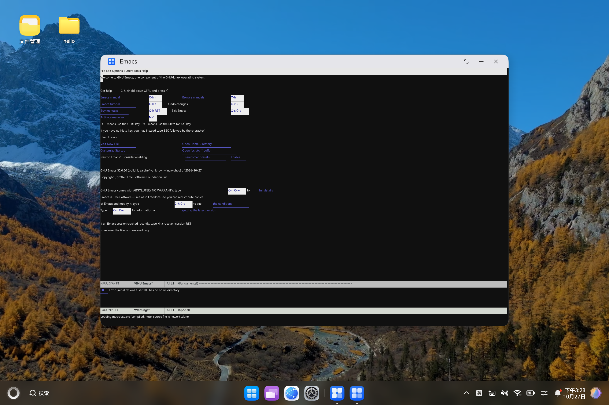
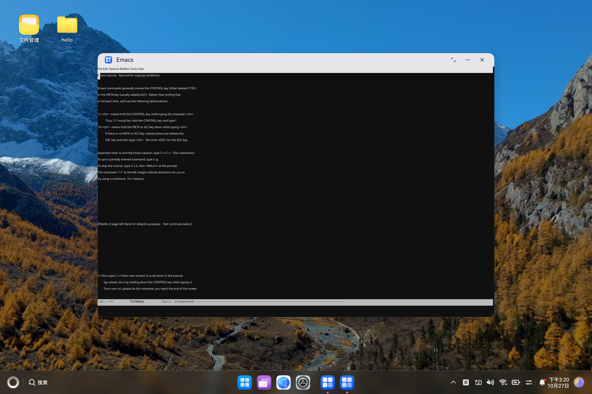
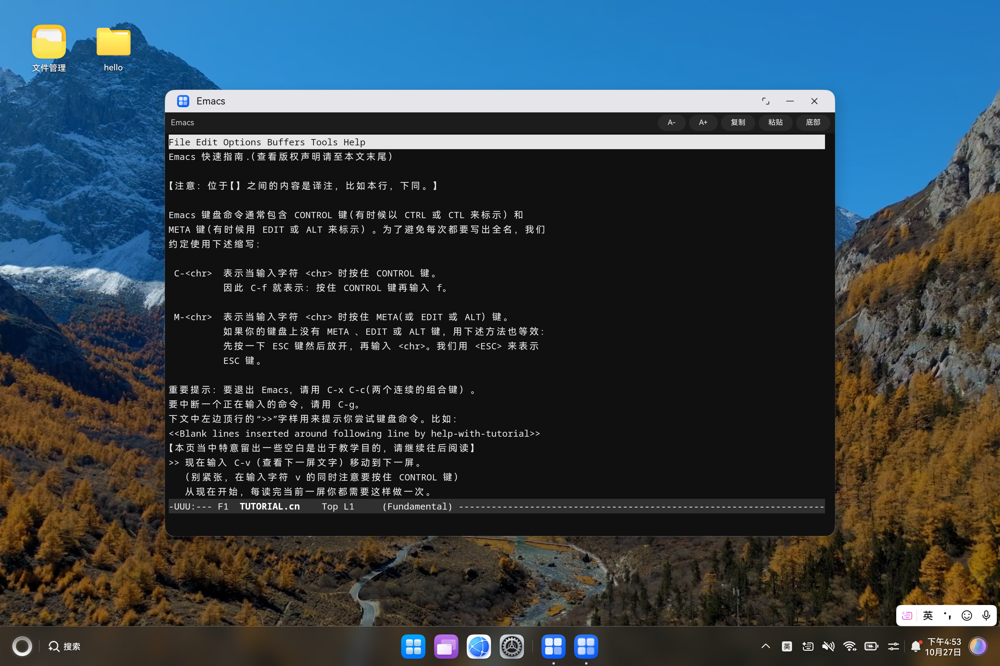
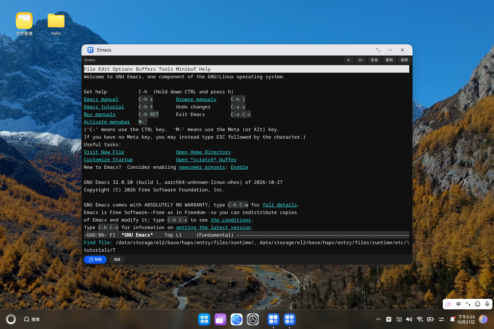

# GNU Emacs on HarmonyOS NEXT — 移植状态

> 目标：把 Emacs 32.0.50 移植为 HarmonyOS NEXT 原生应用（bundle `emacs.hmos.org`，设备 hm-pc / API 24），
> 采用「终端优先」路线：Emacs 以 tty 模式运行，由应用内 VT 终端负责渲染与键盘输入。



## 1. 当前进度（2026-10-27）

| 里程碑 | 状态 |
| --- | --- |
| aarch64-linux-ohos 交叉编译（temacs / libemacs.so） | ✅ 完成 |
| 设备侧 HAP 构建、签名、安装、启动 | ✅ 完成 |
| 设备能力验证（pty / fork / 字体 / /proc / dlopen） | ✅ 完成 |
| 运行时（lisp/etc/terminfo）打包与首次安装 | ✅ 完成 |
| 设备端自我 dump（pdumper，首次启动生成 `bootstrap-emacs.pdmp`） | ✅ 完成 |
| Emacs 在设备上以 tty 模式运行 | ✅ 完成 |
| 终端前端：xterm.js（ArkWeb WebView）+ 原生 pty 后端 | ✅ 完成，替代早期手写 Canvas 版本 |
| 渲染质量：真彩色、粗体/下划线/反色、光标闪烁、字体缩放 | ✅ 完成 |
| 滚动历史（20000 行）、触摸/滚轮滚动、滚动条 | ✅ 完成 |
| 选中复制 / 全选 / 系统 PasteButton 粘贴（含中文） | ✅ 完成 |
| 鼠标选择、URL 识别（WebLinks） | ✅ 完成 |
| 中文 IME：由 WebView 内 xterm 的 textarea 直接接管系统输入法 | ✅ 完成 |
| 窗口尺寸同步（FitAddon → resize → TIOCSWINSZ + SIGWINCH） | ✅ 完成 |
| 窗口拖拽缩放（`setResizeByDragEnabled` + 最小尺寸限制） | ✅ 完成 |
| 系统剪贴板：Emacs kill → OSC 52 → 系统剪贴板 | ✅ 完成 |
| 系统剪贴板：C-y 读取剪贴板（OSC 52 query + `~/.emacs` 绑定） | ⚠️ 受 HarmonyOS 权限限制，见下文 |
| 网络：HTTPS（静态 GnuTLS 3.8.9 + CA bundle） | ✅ 完成，`package-refresh-contents` 拉取 803 个包 |
| 原生 XComponent 渲染（性能优化，可选） | ⏳ 待做 |



xterm.js 终端打开 `TUTORIAL.cn`（中文渲染与对齐）：



带工具栏与系统粘贴按钮的完整界面：



实际验证过的操作：

- 启动后显示 Emacs 启动画面（菜单栏、按钮、`*GNU Emacs*` 与 `*Warnings*` 窗口、模式行）。
- `C-h t` 打开 `TUTORIAL` 并正确渲染；在缓冲区输入字符后模式行变为 `**`（已修改）。
- `C-x C-f` 打开 minibuffer，回显 `Find file: /data/storage/el2/base/haps/entry/files/runtime/`。
- 窗口大小变化后应用会重新计算 cols×rows，通过 `TIOCSWINSZ` + `SIGWINCH` 通知 Emacs 重绘。
- 中文输入：点右下角 `EN/中`（或按 F12）切到 IME 模式，此时焦点在一个 2×2 的隐藏 `TextInput` 上，
  输入法提交的文本经 `onChange` 写入 pty；再点一次（或 F12）切回终端模式，Ctrl/Meta 快捷键恢复。
  画布右下角的按钮由终端自身绘制（ArkUI 的 Button 会被 Canvas 覆盖，因此用 Canvas 绘制 + `onTouch` 命中检测）。

## 2. 架构

```
┌──────────────────────── HAP: emacs.hmos.org ────────────────────────┐
│ ArkTS 页面 (pages/Index.ets)                                        │
│   ├── Web 组件加载 rawfile/web/index.html（xterm.js + fit + links）  │
│   ├── javaScriptProxy: write / resize / ready / copy / paste / openUrl│
│   ├── readOutput → runJavaScript termWrite(...)（16ms 批量泵送）      │
│   ├── 顶部 HTML 工具栏：A- / A+ / 全选 / 复制 / 底部（字号存 localStorage）│
│   ├── 底部 ArkUI 栏：系统 PasteButton（绕开 READ_PASTEBOARD 限制）+ 键盘聚焦│
│   └── libentry.so (NAPI, C++)                                       │
│         ├── startEmacs(args, env, cwd, cols, rows)                   │
│         │     posix_openpt() → 设置 winsize → fork() → 子进程:        │
│         │       setsid + TIOCSCTTY + dup2(slave→0,1,2)               │
│         │       env: TERM/EMACSLOADPATH/EMACSDATA/...                │
│         │       dlopen("libemacs.so") → dlsym("main") → emacs main    │
│         ├── readOutput()（UTF-8 边界安全解码）/ writeInput() / resizeTerm()│
│         ├── 运行时安装：rawfile 里的 emacs-runtime.tar.gz → files/runtime│
│         └── buildId()/libemacsVersion()/fileRead()/fileWrite()       │
│ libs/arm64-v8a/libemacs.so     Emacs 主体（未 dump）                  │
└─────────────────────────────────────────────────────────────────────┘
```

要点：

- 应用沙箱内 `posix_openpt/grantpt/unlockpt`、`fork`、`/system/fonts`、`/proc`、`dlopen` 均可用；
  但对应用数据目录里的可执行文件 `execve` 被 SELinux 拒绝（`EACCES`），因此采用 **fork + dlopen + 进程内调用
  `emacs main`**，而不是 exec 一个 emacs 可执行文件。
- pty 的窗口尺寸必须在 **slave fd** 上设置（在 master 上 `TIOCSWINSZ` 虽然返回 0，但 Emacs 读不到）；
  之后每次 resize 都重新 ioctl 并额外 `kill(child, SIGWINCH)` 作为兜底。
- `libemacs.so` 由 Emacs 的对象文件直接 `-shared` 链接而来（导出 `main`），不经过 Emacs 官方 Android 构建体系。
- 首次启动在设备上生成 pdump：`emacs -batch -l loadup --temacs=pbootstrap`，产物为
  `files/runtime/bootstrap-emacs.pdmp`（约 20 MB）。之后用 `--dump-file=...` 启动。
- dump 与 `libemacs.so` 二进制强绑定：`dump.stamp` 记录 `libentry` 构建时间 + `libemacs.so` 大小/mtime，
  不匹配时应用会自动删除旧 dump 并重新 dump。
- 终端前端使用 **xterm.js 5.3**（VS Code 同款），负责 VT 解析、真彩色、滚动历史、选择、鼠标上报、
  URL 识别与 IME；ArkTS 只做 pty 数据泵送与系统能力桥接，避免手写 VT/渲染造成的不一致。
- 键盘与 IME 由 xterm 的隐藏 textarea 接管，系统输入法可直接输入中文；不再需要手动切换 IME 模式。
- 剪贴板：
  - **写**（Emacs kill → 系统剪贴板）：xterm.js 注册 OSC 52 处理器，`~/.emacs` 里打开
    `tty-select-active-regions` + `xterm--set-selection`，kill 时 Emacs 发 `ESC ]52;c;BASE64`，
    页面解码后经 NAPI 写入系统剪贴板。
  - **读**（外部复制 → Emacs C-y）：Emacs 侧把 `C-y` 绑定到 `ohos-yank`，通过 `gui-get-selection`
    发 OSC 52 查询；终端用已知的剪贴板内容应答。注意 HarmonyOS 把剪贴板读取限制在
    `ohos.permission.READ_PASTEBOARD`（system_basic，普通应用无法申请，实测声明后安装直接失败），
    唯一合规通道是 **PasteButton 安全组件**（底部「粘贴」按钮）。因此纯键盘 C-y 只能拿到
    应用已经见过的剪贴板内容；外部新复制的内容请先点一次底部「粘贴」。
- 网络：Emacs 交叉编译时静态链接 GnuTLS 3.8.9（依赖 nettle/libtasn1/libunistring/gmp，均为
  aarch64-ohos 静态 PIC 构建），并把 Mozilla CA bundle 随 HAP 安装到 `runtime/etc/ssl/ca-bundle.crt`，
  在 `~/.emacs` 中设置 `gnutls-trustfiles`；`module.json5` 声明 `ohos.permission.INTERNET`。
- pty 输出在 C++ 侧做 UTF-8 边界安全解码（read 可能截断多字节字符），再交给 xterm。

## 3. 构建

依赖（均已在本机装好，前缀 `/home/song/opt`）：

| 组件 | 位置 | 说明 |
| --- | --- | --- |
| autoconf 2.72 | `/home/song/opt/autoconf` | Emacs git 仓库需要 |
| texinfo 7.1 | `/home/song/opt/texinfo` | configure 需要 makeinfo |
| ncurses 6.5 (narrow, PIC) | `/home/song/opt/ohos-deps` | 目标端 tputs/terminfo |
| gmp 6.3.0 (PIC) | `/home/song/opt/ohos-deps` | Emacs bignum |
| qemu-user-static | `/home/song/opt/sysroot-host` | 本地跑 aarch64 二进制辅助调试 |
| OHOS SDK / NDK | `commandline-tools-linux-x64-26.0.0.851` | clang 15 / API 26 |

脚本：

```bash
# 1. 宿主 x86_64 Emacs（提供 make-docfile 等构建期工具）
#    已构建：build-host/
# 2. 目标端 Emacs（build-ohos/），生成 temacs 与对象文件
scripts/build-emacs-ohos.sh            # 已配置时增量构建
scripts/build-emacs-ohos.sh --reconfigure
# 3. 链接 libemacs.so 并复制到 app/entry/libs/arm64-v8a/
scripts/build-libemacs.sh
# 4. 打包 + 签名 + 安装 + 启动
scripts/deploy.sh
```

注意：`hvigorw` 的增量原生产物有时不会重新编译 `entry/src/main/cpp`，改完 NAPI 代码后建议先手动执行
`$OHOS_NATIVE/build-tools/cmake/bin/ninja -C entry/.cxx/default/default/debug/arm64-v8a`，
确认 `libentry.so` 里包含新字符串后再 `scripts/deploy.sh`。

签名材料：`refs/cert1.cer`（3 级链）、`refs/emacs-hmosDebug.p7b`（bundle `emacs.hmos.org`，
UDID 已绑定本机）、`/home/song/Desktop/hmtest/sign-material/demo.p12`（alias `demo_key`）。

设备：`192.168.102.170:39681`（hm-pc，API 24，MNT-W54 6.1.0.135，Kirin X90，2880×1920）。

## 4. 对 Emacs 源码的修改（分支 `ohos`）

| 文件 | 修改 | 原因 |
| --- | --- | --- |
| `configure.ac` | 检测 `*-ohos*` host，定义 `HAVE_OHOS` | 端口开关 |
| `src/sysdep.c` | `posix_close` 回退在 OHOS 上启用；SIGSEGV 时打印 `si_addr/pc/sp` | OHOS 的 `unistd.h` 声明了 `POSIX_CLOSE_RESTART` 却没有 `posix_close` |
| `src/emacs.c` | OHOS 上 dump 时也调用 `set_initial_environment()`；`load_pdump` 接受 `--dump-file` | dump 期间 `egetenv` 为空导致找不到 lisp；非 Android 平台默认不支持 `--dump-file` |
| `src/lread.c` | OHOS 上 dump 时允许 `EMACSLOADPATH` | 设备端自我 dump 必须使用设备路径 |
| `src/fileio.c` | `get_homedir` 在 `egetenv` 为空时回退到 C 的 `getenv("HOME")`；`~USER` 查不到 passwd 时回退到 HOME | 应用进程没有 passwd 条目，否则启动时误报 “User N has no home directory” |

> 早期版本曾在 ArkTS 里手写 VT 解析器 + Canvas 渲染，现已由 xterm.js 取代（备份在 `backup/ets-*`）。

## 5. 运行时包布局（files/runtime）

```
runtime/
├── lisp/           # emacs/lisp（含 .elc）
├── etc/            # emacs/etc + 目标端生成的 DOC
├── leim/
├── terminfo/x/xterm-256color
├── bootstrap-emacs.pdmp   # 设备首次启动生成
├── dump.stamp
├── home/ tmp/             # HOME / TMPDIR
├── emacs-log.txt          # pty 原始输出（调试）
└── emacs-stderr.txt       # 子进程 stderr（调试）
```

打包源：`app/entry/src/main/resources/rawfile/emacs-runtime.tar.gz`（59 MB，解压约 200 MB）。
安装由 libentry.so 内的 zlib + tar 解包线程完成（`startInstallRuntime` / `installState`），
解包后会把所有 `.elc` 的 mtime 刷新，避免 “source file is newer” 警告。

## 6. 网络与包管理

- 交叉编译依赖（均构建到 `/home/song/opt/ohos-deps`）：
  `nettle 3.9.1`、`libtasn1 4.19.0`、`libunistring 1.2`、`gnutls 3.8.9`（Debian orig tarball），
  统一用 `--host=aarch64-linux-gnu` + `CC=clang --target=aarch64-linux-ohos`、`--disable-shared -fPIC`。
- `scripts/build-emacs-ohos.sh` 使用 `--with-gnutls`，`LIBS` 追加
  `-lgnutls -lunistring -lhogweed -lgmp -lnettle -ltasn1 -lz`；`scripts/build-libemacs.sh` 同步。
- CA：`rawfile/home-init.tar.gz` 含 `etc/ssl/ca-bundle.crt`（Mozilla bundle），首次启动解压到
  `runtime/etc/ssl/`，`~/.emacs` 设置 `gnutls-trustfiles`。
- 验证：`M-x package-refresh-contents` → `Package refresh done`，`M-x list-packages` 显示
  gnu/nongnu 共 803 个包（见 `screenshots/2026-10-27-packages.png`）。

## 6.0 启动流程与自愈

- 启动顺序：`aboutToAppear` → 解压 `home-init.tar.gz`（`~/.emacs` + CA）→ 校验
  `dump.stamp`（`buildId` + `libemacs.so` 大小/mtime）→ 需要时重跑 dump → WebView `ready`
  → `startEmacs --dump-file=...` → 16ms 泵送输出。
- 实测：设备上 dump 约 **2 秒**（`dump ok after 2023 ms`）；冷启动到出现启动画面约 1 秒。
  每次安装新 HAP 后 `libemacs.so` 的 mtime 变化会触发一次重 dump，属正常现象。
- 容错：WebView 12 秒未 ready、dump 超时（240 秒）或 dump 失败时，界面会显示原因和「重试」按钮，
  不再停在空白窗口。启动关键节点写入 hilog（tag `emacs-term`）：
  `startup buildId=...`、`decideStart stampMatch=...`、`startDump`、`dump ok after ... ms`、
  `webReady cols=... rows=...`、`startNormal ...`。

## 6.1 窗口尺寸

- `EntryAbility.onWindowStageCreate` 调 `setResizeByDragEnabled(true)` 与 `setWindowLimits`，
  `module.json5` 声明 `supportWindowMode: fullscreen/split/floating`。
- 拖拽窗口 → ArkUI `onAreaChange` → `termFit()` → xterm `onResize` → NAPI `resizeTerm`。
- OHOS 上对 pty **slave** 调 `TIOCSWINSZ` 会返回 EACCES（13），因此 `SetWindowSize` 先试 slave、
  失败再对 **master** 设置（master 成功），再从 slave 读回尺寸并 `SIGWINCH`。

## 7. 已知问题 / 待办

1. **粘贴**：读取系统剪贴板必须经 `PasteButton` 安全组件点击；HTML 工具栏里的「粘贴」已移除，
   统一使用底部系统按钮。粘贴走 xterm 的 bracketed paste（`ESC[200~`/`201~`），普通 buffer 中
   多行文本会原样插入；在启动画面等特殊 buffer 里 Emacs 未绑定 `xterm-paste`，会提示 undefined
   （先 `C-x b` 进入普通 buffer 再粘贴即可）。
2. **C-y 读外部剪贴板**：`ohos-yank` 会优先使用 OSC 52 查询到的剪贴板文本，但普通应用没有
   `READ_PASTEBOARD` 权限，查询通常返回空；此时回退到 kill ring，并提示先点底部「粘贴」授权。
   这是 HarmonyOS 的安全限制，不是终端实现问题。
3. **WebView 依赖**：终端前端跑在 ArkWeb 内，首次进入有极短的页面加载时间；
   如需完全原生渲染，可再评估 XComponent + 自绘字形缓存。
4. **`.elc` 来源**：直接使用了源码树里既有的 1645 个 `.elc`（此前在本机 in-tree 编译），
   正式发行应验证或重新编译。
5. **dump 类型**：目前用 `--temacs=pbootstrap`（bootstrap dump）。若需官方 `pdump` 流程，
   需实现两阶段 bootstrap（pbootstrap → 编译 lisp → pdump）。
6. **体积**：HAP 约 66 MB（runtime 压缩包 59 MB + xterm 资源）；后续可裁剪 lisp 源码。
7. **稳定性**：fork 发生在 ArkTS 多线程进程中，当前工作正常，但长期应评估
   `OH_Ability_StartNativeChildProcess`（支持 fd 传递）作为隔离方案。

## 8. 快速验证

```bash
scripts/deploy.sh
# 首次启动会自动安装 runtime 并 dump（约 1-2 分钟），随后自动进入 Emacs
hdc -t 192.168.102.170:39681 shell 'uitest screenCap -p /data/local/tmp/s.png'
hdc -t 192.168.102.170:39681 file recv /data/local/tmp/s.png /tmp/s.png

# 键盘注入示例（C-x C-f）
hdc -t 192.168.102.170:39681 shell 'uitest uiInput keyEvent 2072 2040'
hdc -t 192.168.102.170:39681 shell 'uitest uiInput keyEvent 2072 2022'
```

## 9. 包兼容性索引（Top 100）

在真机上批量验证了 100 个常用包的安装、字节编译、加载和已知限制，结果见
[PACKAGE-INDEX.md](PACKAGE-INDEX.md)。

- 索引数据：`tools/package-index/index.json`、`index.csv`
- 逐包原始结果：`tools/package-index/results/`
- 复现：`tools/package-index/run-device.sh` → `tools/package-index/build-index.py`

测试通过应用内的 headless 探针模式完成：`runtime/package-index/queue.txt` 存在时，
`Index.ets` 会为每个包启动一个独立的 `emacs --batch -Q -l runner.el` 子进程，
避免包之间的全局状态污染；单包超时 300 秒。
